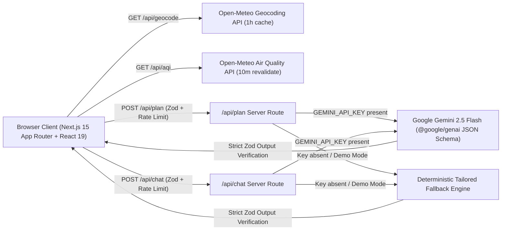

# SmogShield AI

**SmogShield AI** is a production-ready, full-stack GenAI Urban Air Quality Assistant built for families and communities navigating severe winter smog and urban air pollution. It combines real-time air quality telemetry from Open-Meteo with **Google Gemini (`gemini-2.5-flash`)** structured reasoning to deliver smog-peak-aware daily routines, budget-friendly indoor air quality hacks, sustainable low-emission swaps, an interactive **"What-If" Impact Calculator**, and a grounded **AI Smog Q&A Assistant**.

---

## Core Capabilities

1. **Location & Live AQI Dashboard**
   - Debounced city search autocomplete powered by the Open-Meteo Geocoding API plus 1-click winter smog presets (**Delhi**, **Lahore**, **Beijing**, **London**, **Los Angeles**).
   - Real-time US AQI radial SVG gauge, EPA severity classification (always pairing high-contrast color with explicit text labels and icons), individual **PM2.5, PM10, NO2, and O3** status cards benchmarked against WHO 2021 guidelines, and a **24-hour diurnal smog peak chart**.
2. **Household & Lifestyle Profile**
   - Captures household size, vulnerable members (children, elderly, asthma/respiratory, pregnant/cardiovascular), primary commute mode, indoor ventilation/purifier setup, and daily outdoor activity level.
3. **GenAI Personalized Action Plan (`gemini-2.5-flash`)**
   - **Low-Emission Daily Routine:** Morning, afternoon, and evening guidance shifted around winter temperature inversion peaks.
   - **Indoor Air Quality Hacks:** Practical budget steps including DIY Corsi-Rosenthal cubes, weatherstripping drafts, cooking exhaust ventilation, 40–50% humidity control, and an **Indoor Plants Reality Check** debunking false-security myths.
   - **Sustainable Alternatives:** Actionable swaps for commuting, winter heating/cooking, and neighborhood habits.
   - **Direct Impact Explainer:** Every single item displays both **Personal Health Impact** (estimated % reduction in PM2.5 inhalation exposure) and **Community / Emission Impact** (estimated weekly kg CO2e and g PM2.5 avoided).
4. **Interactive "What-If" Impact Calculator**
   - Checkboxes on every suggested action dynamically update **"Your Daily Impact"** using multiplicative exposure compounding ($R_{\text{total}} = 1 - \prod (1 - r_i)$, realistically capped at 90%) alongside weekly CO2e, PM2.5, and car-kilometer equivalents.
5. **AI Smog Q&A Assistant**
   - Grounded follow-up chat (`POST /api/chat`) tailored to your selected city's live pollutants, peak smog window, and household risk profile.
6. **Graceful Demo / Fallback Mode**
   - When `GEMINI_API_KEY` is omitted in local or automated test environments, SmogShield AI displays an explicit Demo Mode banner and serves realistic, schema-validated, city- and household-tailored guidance without crashing.

---

## Architecture



---

## How Gemini AI Is Utilized

- **SDK & Model:** Uses the official server-side `@google/genai` SDK calling `gemini-2.5-flash`.
- **Strict Structured JSON Output:** `/api/plan` passes `responseMimeType: "application/json"` and an explicit OpenAPI-subset `responseSchema` (`Type.OBJECT`, `Type.ARRAY`, `Type.NUMBER`, `Type.STRING`) so Gemini returns machine-parseable routines, indoor hacks, sustainable swaps, and quantified impact scores.
- **Double Validation & Prompt Hardening:** All user inputs are sanitized via `src/lib/sanitize.ts` (stripping control characters, delimiters, and role-spoofing prefixes) and validated with `zod` (`src/lib/schemas.ts`) before prompting. Every Gemini JSON output is parsed and re-validated against `geminiPlanOutputSchema` before reaching the client.
- **Zero Client Key Exposure:** `GEMINI_API_KEY` is read strictly inside server-side routes (`src/lib/gemini.ts`) and never prefixed with `NEXT_PUBLIC_`.

---

## Tech Stack

- **Framework:** Next.js 15 (App Router), React 19, TypeScript (`strict: true`, zero `any`)
- **Styling & Visuals:** Tailwind CSS v4, `lucide-react`, lightweight custom SVG gauges & charts
- **AI & Data:** `@google/genai` (`gemini-2.5-flash`), Open-Meteo Air Quality & Geocoding APIs
- **Validation & Security:** `zod`, in-memory sliding-window IP rate limiting (`src/lib/rate-limit.ts`), security headers in `next.config.ts`
- **Testing:** Vitest, `@testing-library/react`, `@testing-library/jest-dom`, `jsdom`

---

## Getting Started

### 1. Install Dependencies

```bash
npm install
```

### 2. Configure Environment Variables

Copy `.env.example` to `.env.local` and optionally add your Google Gemini API key:

```bash
cp .env.example .env.local
```

```env
# Optional — leave blank to run in Graceful Demo Mode
GEMINI_API_KEY=your_gemini_api_key_here
```

### 3. Run Development Server

```bash
npm run dev
```

Open [http://localhost:3000](http://localhost:3000).

---

## Testing & Verification Commands

```bash
# Run ESLint (strict TypeScript + Next.js core-web-vitals)
npm run lint

# Run TypeScript type check
npm run typecheck

# Run Vitest unit & component test suite
npm test

# Build optimized production bundle
npm run build
```

---

## Vercel 1-Click Deployment

1. Push the `smogshield-ai` repository to GitHub/GitLab/Bitbucket.
2. Import the repository into Vercel (auto-detects Next.js 15).
3. Add `GEMINI_API_KEY` in **Project Settings → Environment Variables** (or leave unset to demonstrate Graceful Demo Mode).
4. Click **Deploy**.
